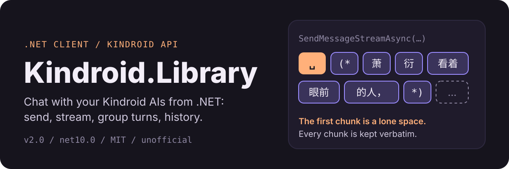

<p align="center">
  
</p>

<p align="center">
  <a href="https://www.nuget.org/packages/Kindroid.Library/"></a>
  <a href="LICENSE.txt"></a>
  <a href="https://dotnet.microsoft.com/"></a>
  <a href="https://learn.microsoft.com/dotnet/visual-basic/"></a>
  <a href="https://ko-fi.com/Y0F020WAJC"></a>
</p>

`Kindroid.Library` is an unofficial .NET client for the [Kindroid AI public REST API](https://kindroid.ai/docs/article/api-documentation/). One `KindroidClient` covers every documented endpoint: single-AI chat, group chat, streaming replies, history, rewind, chat breaks, and persona updates. Written in VB.NET, usable from any .NET language. Not an official Kindroid SDK.

> [!IMPORTANT]
> **Upgrading from 1.x?** 2.0 is a breaking release. In 1.x, API errors (`400`, `404`, `429`, …) were **not thrown**: the error text came back as if it were the AI's reply. They now throw `KindroidException`. Chat history parsing, streaming (hangs, dropped whitespace) and the VB streaming example were also broken and are fixed.
> See the [CHANGELOG](CHANGELOG.md) and the [migration guide](../../wiki/Migrating-to-2.0).

## Install

```
dotnet add package Kindroid.Library
```

Requires .NET 10 and a Kindroid API key (`kn_…`, from your Profile Settings). Treat the key like a password: it can do anything to your account. Keep it in user-secrets or an environment variable, never in source control.

## Quickstart

Send a message, then stream the next reply as it is generated.

### Visual Basic

```vb
Imports Kindroid.Library
Imports Kindroid.Library.Exceptions

Using client As New KindroidClient("kn_yourApiKeyHere")
    Try
        Dim reply = Await client.SendMessageAsync("ai_abc123", "Hello!")

        ' Streaming: print chunks as they arrive
        Await client.SendMessageStreamAsync("ai_abc123", "Tell me a story.").
            ForEachAsync(Sub(chunk) Console.Write(chunk))

        ' ...or collect the whole reply
        Dim story = Await client.SendMessageStreamAsync("ai_abc123", "Another one.").ReadAllTextAsync()
    Catch ex As KindroidRateLimitException
        Console.WriteLine("Slow down: " & ex.ResponseBody)
    Catch ex As KindroidException
        Console.WriteLine($"Kindroid API error {ex.StatusCode}: {ex.ResponseBody}")
    End Try
End Using
```

### F#

```fsharp
open System
open Kindroid.Library
open Kindroid.Library.Exceptions

task {
    use client = new KindroidClient("kn_yourApiKeyHere")
    try
        let! reply = client.SendMessageAsync("ai_abc123", "Hello!")

        do! client.SendMessageStreamAsync("ai_abc123", "Tell me a story.")
                  .ForEachAsync(fun chunk -> Console.Write chunk)
    with
    | :? KindroidRateLimitException as ex -> printfn "Slow down: %s" ex.ResponseBody
    | :? KindroidException as ex -> printfn "Kindroid API error %d: %s" ex.StatusCode ex.ResponseBody
}
```

### C#

```csharp
using Kindroid.Library;
using Kindroid.Library.Exceptions;

using var client = new KindroidClient("kn_yourApiKeyHere");
try
{
    string reply = await client.SendMessageAsync("ai_abc123", "Hello!");

    await foreach (var chunk in client.SendMessageStreamAsync("ai_abc123", "Tell me a story."))
        Console.Write(chunk);
}
catch (KindroidRateLimitException ex) { Console.WriteLine("Slow down: " + ex.ResponseBody); }
catch (KindroidException ex) { Console.WriteLine($"Kindroid API error {ex.StatusCode}: {ex.ResponseBody}"); }
```

### C++/CLI

> The VB, F# and C# samples above are compiled against the library. This C++/CLI sample is **not compiled**; C++/CLI has no `await`, so it uses the blocking API.

```cpp
using namespace System;
using namespace Kindroid::Library;
using namespace Kindroid::Library::Exceptions;

KindroidClient^ client = gcnew KindroidClient("kn_yourApiKeyHere");
try {
    String^ reply = client->SendMessage("ai_abc123", "Hello!");
    Console::WriteLine(reply);
} catch (KindroidException^ ex) {
    Console::WriteLine("Kindroid API error {0}: {1}", ex->StatusCode, ex->ResponseBody);
} finally {
    delete client;
}
```

`KindroidClient` is `IDisposable`; dispose it (or use `using`) unless you passed in your own `HttpClient`.

## What you get

- **Single AI**: send, stream, history, rewind (undo), chat break, persona update.
- **Group chat**: user text/voice messages, turn-taking, AI replies (sync or stream), history, rewind, chat break, roster/config update. `GroupRunTurnsAsync` drives the whole turn loop for you.
- **Streaming** as `IAsyncEnumerable(Of String)`, plus `ForEachAsync` / `ReadAllTextAsync` helpers for languages without `await foreach`.
- **Paging helpers**: `EnumerateChatMessagesAsync` walks a whole history for you.
- **Real error types**: `KindroidAuthenticationException` (401), `KindroidForbiddenException` (403), `KindroidNotFoundException` (404), `KindroidRateLimitException` (429), all deriving from `KindroidException`.
- **Fail fast**: bad arguments (blank ids, empty messages, `limit` outside 1-100, odd single-AI rewind counts) are rejected locally before spending a request.
- **Options**: configurable timeout (default 10 min), optional automatic retry of `429`, bring-your-own `HttpClient`.

## How streaming behaves

Streaming replies arrive as `text/event-stream`, but the body is **plain text, not SSE**, cut into tiny token fragments. Whitespace-only chunks are real text (the first chunk of a reply was observed to be a single space), so the library never filters or trims them: concatenate chunks exactly as received. Streams are lazy, always terminate (errors are thrown from enumeration instead of hanging), and disposing one early aborts the HTTP request.

Visual Basic has no `Await ForEach`, and its compiler rejects `Await` inside `Finally` (error BC36943), so the usual manual enumerator loop does not compile in VB. Use `ForEachAsync` / `ReadAllTextAsync`. Details: [Streaming](../../wiki/Streaming).

## Good to know

- **Rate limits are strict.** The limiter is per API key, applies to every request while active, and sends no `Retry-After` header. A burst of about a dozen quick requests triggered it; `get-chat-messages` also allows only 600 requests per 24 hours. Space calls out, use page size 100 when reading history, or set `KindroidClientOptions.MaxRetries`.
- **History is oldest first**, and without a cursor you always get the oldest page.
- **`ChatBreak` does not delete history**; the greeting is appended. `wipeCascaded` permanently erases long-term memory.
- **The server is inconsistent about unknown ids** (`400`, `404`, or an empty `200`). See [Server Behaviour](../../wiki/Server-Behaviour) for everything observed.

## How well is it tested?

| Area | Status |
|---|---|
| Single-AI endpoints (send, stream, history, rewind, chat break, update) | Exercised against a live Kindroid account |
| Group endpoints (user message, turn, AI reply + stream, history, rewind, chat break, update) | Exercised against a live Kindroid group |
| Library behaviour (errors, retry, validation, paging, streaming edge cases) | 27 offline unit tests (`Library.Tests`) |
| Discord bot endpoint (`DiscordBot`, `HashRequester`) | Implemented from the docs, **not verified live** (needs a Discord share code) |
| C++/CLI samples | **Not compiled** |

## Documentation

| Page | Description |
|---|---|
| [Getting Started](../../wiki/Getting-Started) | Install, API keys, client options, first request |
| [Single-AI Chat](../../wiki/Single-AI-Chat) | Send, history, rewind, chat break, update persona |
| [Group Chat](../../wiki/Group-Chat) | Multi-AI conversations and the turn loop |
| [Streaming](../../wiki/Streaming) | What the server sends and how to consume it per language |
| [Error Handling](../../wiki/Error-Handling) | Exception types, status codes, rate limits |
| [Server Behaviour](../../wiki/Server-Behaviour) | Quirks observed on the live server |
| [Models Reference](../../wiki/Models-Reference) | Every request/response type |
| [Migrating to 2.0](../../wiki/Migrating-to-2.0) | Breaking changes from 1.x |

## Contributing

Issues and pull requests are welcome. Since this wraps a third-party API, please check endpoint-behaviour changes against the [official Kindroid API docs](https://kindroid.ai/docs/article/api-documentation/). To probe the live server yourself, set `Kindroid:API_KEY` in user-secrets and run `dotnet run --project Test -- probe <scenario>` (see `Test/Probe.vb`).

## License

Released under the [MIT License](LICENSE.txt).
